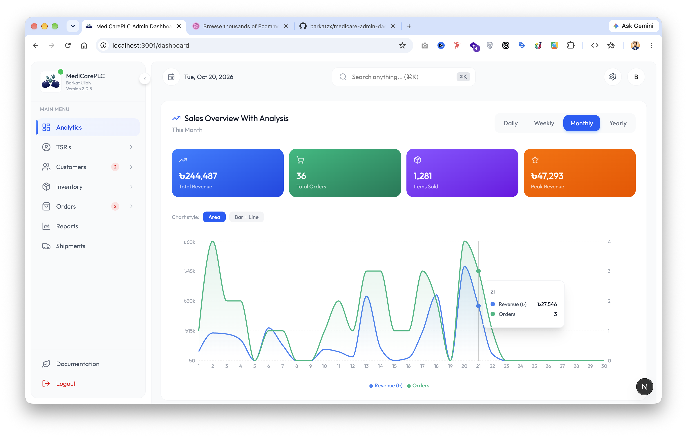

<div align="center">

# 🏥 Medicare Admin Dashboard

A modern, light-themed admin dashboard for managing a medicine distribution business — products, orders, users, distributors, TSR (Territory Sales Representative) activity and sales reports.




</div>

---

## ✨ Features

### 🔐 Authentication

- Admin login with token-based sessions
- Client-side route protection for dashboard navigation
- Session restored on reload

The client-side route guard is a navigation aid, not an authorization boundary. The API must validate sessions and enforce admin permissions for protected data and actions.

### 📊 Dashboard & Reports

- Overview of key store metrics
- Interactive charts powered by Recharts
- Sales reports
- Today's shipments page

### 💊 Products

- All products with search and pagination
- Trending and featured products
- Low-stock and out-of-stock lists
- Category management

### 🛒 Orders

- Pending (active) orders: pending, confirmed, processing and shipped
- Delivered and cancelled orders
- Update order status and confirm payments
- Search, status tabs, and pagination that appears only when there is more than one page (20 per page)

### 👥 Users

- Pending users awaiting approval
- Active users
- Approve, delete, and promote customers to TSR
- Search by email or phone

### 🚚 Distributors & TSR

- Distributor list and detail pages
- TSR summary and TSR sales tracking

### ⚙️ Settings & Account

- Profile details and editing
- Saved address management (add, edit, set default)
- Header with global search (`⌘K` / `Ctrl+K`), quick links to settings and notifications, and an avatar menu showing the admin's name and role

### 🎨 UI / UX

- Clean light theme only
- Responsive, collapsible sidebar
- Toast notifications via `react-hot-toast`
- Built-in documentation page

---

## 🛠️ Tech Stack

| Area          | Technology                                     |
| ------------- | ---------------------------------------------- |
| Framework     | [Next.js 16](https://nextjs.org/) (App Router) |
| UI library    | React 18                                       |
| Language      | TypeScript                                     |
| Styling       | Tailwind CSS 4                                 |
| State         | Redux Toolkit, React Redux                     |
| Forms         | React Hook Form                                |
| Charts        | Recharts                                       |
| Icons         | Lucide React                                   |
| Dates         | date-fns                                       |
| Notifications | react-hot-toast                                |

---

## 📁 Project Structure

```
├── app/
│   ├── login/                 # Admin login
│   └── dashboard/
│       ├── products/          # all, trending, featured, low-stock, out-of-stock, categories
│       ├── orders/            # pending, delivered, cancelled
│       ├── users/             # pending, active, TSR
│       ├── distributors/      # list + detail
│       ├── tsr-info/          # TSR summary & sales
│       ├── reports/
│       ├── today-shipments/
│       ├── settings/
│       └── documentation/
├── components/                # Layout (Header, Sidebar, ProtectedRoute), UI, providers
├── config/api/                # API client and per-resource endpoints
├── store/                     # Redux store and slices
└── public/                    # Static assets (logo, cover, fonts)
```

## 👤 Author

**Barkat Ullah** — [@Barkatzx](https://github.com/Barkatzx)
